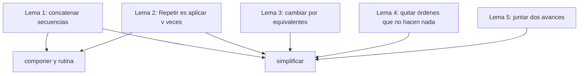

# Correción 

## Notación

- Un estado es $e = (x, y, m)$, con $m$ la dirección a la que mira.
- $\mathrm{ej}(e, o)$ es el estado que devuelve `ejecutar(e, o)`.
- Abrevio las órdenes: $\mathrm{Av}(n)$ es `Avanzar(n)`, $\mathrm{Gi}(s)$ es
  `Girar(s)`, $\mathrm{Rep}(v, o)$ es `Repetir(v, o)` y $\mathrm{Seq}(l)$ es
  `Secuencia(l)`.
- $[\ ]$ es la lista vacía, $p \mathbin{::} r$ es la lista con primer
  elemento $p$ y resto $r$, y $l_1 \mathbin{++} l_2$ es pegar dos listas.
- $f^k$ es aplicar la función $f$ un total de $k$ veces. $f^0$ no hace nada.

## Punto 1 - `girar`

`girar` es un `match` sobre la pareja `(d, s)` con los 8 casos. Como
`Direccion` y `Sentido` son `sealed trait`, se comprueba que no
falte ninguno, así que la función está definida para todas las entradas.

Dos propiedades se comprueban mirando los 8 casos:

$$\text{girar}(\text{girar}(d, \text{Derecha}), \text{Izquierda}) = d$$

$$\text{girar}^4(d, \text{Derecha}) = d$$

Por ejemplo, para Norte, Norte pasa a Este y vuelve a Norte y cuatro giros
dan Norte, Este, Sur, Oeste y otra vez Norte. Para las otras tres
direcciones el cálculo es igual.

## Punto 2 - `ejecutar`

**Definición** (es lo que hace el código, un caso por orden):

$$\mathrm{ej}(e, \mathrm{Av}(n)) = \begin{cases}
(x,\ y+n,\ \text{Norte}) & \text{si } m = \text{Norte} \\
(x+n,\ y,\ \text{Este}) & \text{si } m = \text{Este} \\
(x,\ y-n,\ \text{Sur}) & \text{si } m = \text{Sur} \\
(x-n,\ y,\ \text{Oeste}) & \text{si } m = \text{Oeste}
\end{cases}$$

$$\mathrm{ej}((x, y, m), \mathrm{Gi}(s)) = (x,\ y,\ \text{girar}(m, s))$$

$$\mathrm{ej}(e, \mathrm{Rep}(v, o)) = \begin{cases}
e & \text{si } v \leq 0 \\
\mathrm{ej}(\mathrm{ej}(e, o),\ \mathrm{Rep}(v-1, o)) & \text{si } v > 0
\end{cases}$$

$$\mathrm{ej}(e, \mathrm{Seq}([\ ])) = e \qquad
\mathrm{ej}(e, \mathrm{Seq}(p \mathbin{::} r)) = \mathrm{ej}(\mathrm{ej}(e, p),\ \mathrm{Seq}(r))$$

**Tres observaciones** que uso más adelante:

1. $\mathrm{Av}(n)$ no cambia la dirección $m$.
2. $\mathrm{ej}(e, \mathrm{Av}(0)) = e$, porque se suma 0.
3. $\mathrm{ej}(e, \mathrm{Seq}([\ ])) = e$.

**Terminación.** Defino un peso $w$ para cada orden:

$$w(\mathrm{Av}(n)) = w(\mathrm{Gi}(s)) = 1 \qquad
w(\mathrm{Rep}(v, o)) = 1 + \max(v, 0) \cdot w(o) \qquad
w(\mathrm{Seq}(l)) = 1 + \sum_{p \in l} w(p)$$

En cada llamado recursivo de `ejecutar` el peso baja:

- $\mathrm{Rep}(v, o)$ con $v > 0$ llama con $o$ y con $\mathrm{Rep}(v-1, o)$. Los
  dos tienen menos peso que $\mathrm{Rep}(v, o)$.
- $\mathrm{Seq}(p \mathbin{::} r)$ llama con $p$ y con $\mathrm{Seq}(r)$. Los dos
  tienen menos peso.

Como $w$ es un entero positivo que siempre baja, la recursión termina. Los
casos base son $\mathrm{Rep}(v, o)$ con $v \leq 0$ y $\mathrm{Seq}([\ ])$.

## Lemas

Estos cuatro resultados salen de la definicion y se usan en los puntos 4 y 5.

### Lema 1 - concatenar secuencias

$$\mathrm{ej}(e,\ \mathrm{Seq}(l_1 \mathbin{++} l_2)) = \mathrm{ej}(\mathrm{ej}(e, \mathrm{Seq}(l_1)),\ \mathrm{Seq}(l_2))$$

*Demostración, por inducción sobre $l_1$.*

- **Caso base** $l_1 = [\ ]$: el lado derecho es
  $\mathrm{ej}(\mathrm{ej}(e, \mathrm{Seq}([\ ])), \mathrm{Seq}(l_2))$. Por la observación 3
  es $\mathrm{ej}(e, \mathrm{Seq}(l_2))$, que es el lado izquierdo.
- **Paso** $l_1 = p \mathbin{::} r$:

$$\mathrm{ej}(e, \mathrm{Seq}(p \mathbin{::} (r \mathbin{++} l_2)))
= \mathrm{ej}(\mathrm{ej}(e, p),\ \mathrm{Seq}(r \mathbin{++} l_2))$$

Por hipótesis de inducción, con el estado $\mathrm{ej}(e, p)$:

$$= \mathrm{ej}(\mathrm{ej}(\mathrm{ej}(e, p), \mathrm{Seq}(r)),\ \mathrm{Seq}(l_2))
= \mathrm{ej}(\mathrm{ej}(e, \mathrm{Seq}(p \mathbin{::} r)),\ \mathrm{Seq}(l_2)) \qquad \blacksquare$$

### Lema 2 - `Repetir` es aplicar la orden $v$ veces

Sea $f(e) = \mathrm{ej}(e, o)$. Entonces

$$\mathrm{ej}(e, \mathrm{Rep}(v, o)) = f^{\max(v, 0)}(e)$$

*Demostración, por inducción sobre $\max(v, 0)$.*

- **Caso base** $\max(v, 0) = 0$: $\mathrm{ej}(e, \mathrm{Rep}(v, o)) = e = f^0(e)$.
- **Paso**, con $v > 0$:

$$\mathrm{ej}(e, \mathrm{Rep}(v, o)) = \mathrm{ej}(f(e), \mathrm{Rep}(v-1, o))
= f^{v-1}(f(e)) = f^{v}(e) \qquad \blacksquare$$

**Consecuencia:** si dos órdenes $a$ y $b$ producen el mismo estado para todo
estado, entonces $\mathrm{Rep}(v, a)$ y $\mathrm{Rep}(v, b)$ también.

### Lema 3 - cambiar elementos por equivalentes

Si $\mathrm{ej}(e, a_i) = \mathrm{ej}(e, b_i)$ para todo estado $e$ y para cada
posición $i$, entonces

$$\mathrm{ej}(e, \mathrm{Seq}([a_1, \dots, a_k])) = \mathrm{ej}(e, \mathrm{Seq}([b_1, \dots, b_k]))$$

*Demostración, por inducción sobre $k$.* Para $k = 0$ las dos listas son
vacías. Para $k > 0$:
$\mathrm{ej}(e, \mathrm{Seq}(a_1 \mathbin{::} \cdots)) = \mathrm{ej}(\mathrm{ej}(e, a_1), \mathrm{Seq}(\cdots))$.
Como $\mathrm{ej}(e, a_1) = \mathrm{ej}(e, b_1)$, y por hipótesis de inducción en
el resto, se obtiene lo mismo con los $b_i$. $\blacksquare$

### Lema 4 - quitar una orden que no hace nada

Si $\mathrm{ej}(e, q) = e$ para todo estado $e$, entonces

$$\mathrm{ej}(e,\ \mathrm{Seq}(l_1 \mathbin{++} (q \mathbin{::} l_2))) = \mathrm{ej}(e,\ \mathrm{Seq}(l_1 \mathbin{++} l_2))$$

*Demostración.* Por el lema 1, el lado izquierdo es
$\mathrm{ej}(\mathrm{ej}(\mathrm{ej}(e, \mathrm{Seq}(l_1)), q),\ \mathrm{Seq}(l_2))$. Como $q$ no
cambia el estado, es $\mathrm{ej}(\mathrm{ej}(e, \mathrm{Seq}(l_1)),\ \mathrm{Seq}(l_2))$, que por el
lema 1 es el lado derecho. $\blacksquare$

### Lema 5 - dos avances seguidos

$$\mathrm{ej}(\mathrm{ej}(e, \mathrm{Av}(a)),\ \mathrm{Av}(b)) = \mathrm{ej}(e, \mathrm{Av}(a + b))$$

*Demostración.* Por la observación 1, el robot sigue mirando a la misma
dirección. Si mira al Norte, $(x, y, \text{Norte})$ pasa a
$(x, y + a, \text{Norte})$ y luego a $(x, y + a + b, \text{Norte})$, que es el
resultado de $\mathrm{Av}(a + b)$. Con Este, Sur y Oeste es igual, sumando o
restando en la coordenada que corresponda. $\blacksquare$

## Punto 3 - `cuantasBasicas` y `profundidad`

### `cuantasBasicas`

Defino el número de ordenes básicas que se ejecutan:

$$N(\mathrm{Av}(n)) = N(\mathrm{Gi}(s)) = 1 \qquad
N(\mathrm{Rep}(v, o)) = \max(v, 0) \cdot N(o) \qquad
N(\mathrm{Seq}(l)) = \sum_{p \in l} N(p)$$

`cuantasBasicas(o)` $= N(o)$ para toda orden $o$.

*Demostración, por inducción estructural.*

- $\mathrm{Av}$ y $\mathrm{Gi}$: el código devuelve 1.
- $\mathrm{Rep}(v, o)$: si $v \leq 0$ el código devuelve 0, que es
  $\max(v, 0) \cdot N(o)$. Si $v > 0$ devuelve $v \cdot \text{cuantasBasicas}(o)$,
  que por hipótesis de inducción es $v \cdot N(o)$.
- $\mathrm{Seq}([\ ])$ da 0, la suma vacía. $\mathrm{Seq}(p \mathbin{::} r)$ da
  $\text{cuantasBasicas}(p) + \text{cuantasBasicas}(\mathrm{Seq}(r))$, que por
  hipótesis es $N(p) + \sum_{q \in r} N(q)$. $\blacksquare$

Comprobación con el cuadrado: $N = 4 \cdot (1 + 1) = 8$, y la traza del
informe de proceso tiene 8 pasos.

### `profundidad`

$$P(\mathrm{Av}(n)) = P(\mathrm{Gi}(s)) = 1 \qquad
P(\mathrm{Rep}(v, o)) = 1 + P(o) \qquad
P(\mathrm{Seq}(l)) = 1 + \max(\{0\} \cup \{P(p) : p \in l\})$$

La auxiliar `masHonda(l)` calcula $\max(\{0\} \cup \{P(p) : p \in l\})$.
*Demostración por inducción sobre la lista.* Con $[\ ]$ devuelve 0. Con
$p \mathbin{::} r$ devuelve $\max(P(p), \text{masHonda}(r))$, que por hipótesis
es $\max(P(p), \max(\{0\} \cup \{P(q) : q \in r\}))$. Como $P(p) \geq 1 \geq 0$,
esto es el máximo de toda la lista. $\blacksquare$

Con esto, `profundidad(Seq(Nil))` es $1 + 0 = 1$ y el cuadrado da
$1 + (1 + 1) = 3$.

## Punto 4 - rutinas y funciones de alto orden

### `componer` equivale a ejecutar las dos partes en orden

`componer(o1, o2)` devuelve $\mathrm{Seq}(o_1 \mathbin{::} o_2 \mathbin{::} [\ ])$.

 Para todo estado $e$:

$$\mathrm{ej}(e, \text{componer}(o_1, o_2)) = \mathrm{ej}(\mathrm{ej}(e, o_1),\ o_2)$$

*Demostración.* Por la definición de $\mathrm{Seq}$:

$$\mathrm{ej}(e, \mathrm{Seq}(o_1 \mathbin{::} (o_2 \mathbin{::} [\ ]))) = \mathrm{ej}(\mathrm{ej}(e, o_1),\ \mathrm{Seq}(o_2 \mathbin{::} [\ ]))
= \mathrm{ej}(\mathrm{ej}(\mathrm{ej}(e, o_1), o_2),\ \mathrm{Seq}([\ ]))$$

y por la observación 3 esto es $\mathrm{ej}(\mathrm{ej}(e, o_1), o_2)$. $\blacksquare$

### `rutina` equivale a repetir sus partes

`rutina(p)(g)(v)` devuelve $\mathrm{Rep}(v, \mathrm{Seq}([\mathrm{Av}(p), \mathrm{Gi}(g)]))$.
Sea

$$B(e) = \mathrm{ej}(\mathrm{ej}(e, \mathrm{Av}(p)),\ \mathrm{Gi}(g))$$

el paso "avanzar $p$ y girar hacia $g$".

**Afirmación.** Para todo estado $e$ y todo $v \geq 0$:

$$\mathrm{ej}(e, \text{rutina}(p)(g)(v)) = B^{v}(e)$$

*Demostración.* Por la definición de $\mathrm{Seq}$ y la observación 3, ejecutar
la secuencia $[\mathrm{Av}(p), \mathrm{Gi}(g)]$ desde $e$ da $B(e)$, o sea
$\mathrm{ej}(e, \mathrm{Seq}([\mathrm{Av}(p), \mathrm{Gi}(g)])) = B(e)$ (es el caso de
`componer`). Con el lema 2, tomando $f = B$, queda $\mathrm{ej}(e, \text{rutina}(p)(g)(v)) = B^v(e)$.
$\blacksquare$

Es decir, ejecutar la rutina compuesta es lo mismo que ejecutar sus partes,
avanzar y girar, repetidas $v$ veces.

**Caso del cuadrado.** Con $p = 1$ y $g = \text{Derecha}$ se cumple
$B^4(e) = e$ para cualquier estado $e = (x, y, m)$. En el paso $k$ el robot
avanza una casilla mirando a $\text{girar}^{k-1}(m)$. Las cuatro
direcciones que se recorren son Norte, Este, Sur y Oeste en algún orden, y
sus desplazamientos $(0,1)$, $(1,0)$, $(0,-1)$ y $(-1,0)$ suman $(0, 0)$. Además,
por el punto 1, $\text{girar}^4(m, \text{Derecha}) = m$. Por eso el robot vuelve a
su posición y mira al mismo lado. Desde el inicio lo muestra la traza:
$(0,0,\text{Norte})$ termina en $(0,0,\text{Norte})$.

### `aplicarA`

`aplicarA(es, o)` es `es.map(e => ejecutar(e, o))`. Por la definición de `map`,
la lista de salida tiene la misma longitud que `es`, y su elemento en la
posición $i$ es $\mathrm{ej}(e_i, o)$. Con la lista vacía devuelve la lista
vacía.

### `transformar`

La función recorre la orden con un caso por tipo:
$\text{transformar}(\mathrm{Rep}(v, o), f) = \mathrm{Rep}(v, \text{transformar}(o, f))$ y
$\text{transformar}(\mathrm{Seq}(l), f) = \mathrm{Seq}(\text{map}(\text{transformar}(\cdot, f), l))$,
y solo en las básicas se aplica $f$. Dos propiedades, por inducción
estructural:

1. **Con la identidad no cambia nada:** $\text{transformar}(o, \text{id}) = o$. En las
   básicas devuelve la misma orden y en las compuestas reconstruye lo mismo.
2. **Si $f$ cambia básicas por básicas**, el conteo se conserva:
   $N(\text{transformar}(o, f)) = N(o)$. En las básicas ambos lados valen 1, y en
   $\mathrm{Rep}$ y $\mathrm{Seq}$ la fórmula de $N$ solo depende de la
   estructura, que se conserva. $\blacksquare$

## Punto 5 - `simplificar` no cambia el resultado

**Teorema.** Para toda orden $o$ y todo estado $e$:

$$\mathrm{ej}(e, \text{simplificar}(o)) = \mathrm{ej}(e, o)$$

Llamo $S$ a `simplificar`. La demostración es por inducción estructural sobre
$o$, mirando cada caso del código y la regla del enunciado que aplica.

### Terminación

En cada llamado, `simplificar` se aplica a una orden de adentro (la de un
$\mathrm{Rep}$ o un elemento de un $\mathrm{Seq}$), que tiene menos peso $w$.
En `juntar`, el primer caso reemplaza dos elementos por uno, así que la lista
se acorta, y los otros casos consumen un elemento. Todo termina.

### Casos

**Regla 1, `Avanzar(0)`:** $S(\mathrm{Av}(0)) = \mathrm{Seq}([\ ])$. Por las observaciones 2
y 3, $\mathrm{ej}(e, \mathrm{Av}(0)) = e = \mathrm{ej}(e, \mathrm{Seq}([\ ]))$. ✓

**Básicas:** $S(\mathrm{Av}(n)) = \mathrm{Av}(n)$ con $n \neq 0$ y $S(\mathrm{Gi}(s)) = \mathrm{Gi}(s)$.
Es la misma orden. ✓

**Regla 1, `Repetir` con $v \leq 0$:** $S(\mathrm{Rep}(v, o)) = \mathrm{Seq}([\ ])$. Por la
definición, $\mathrm{ej}(e, \mathrm{Rep}(v, o)) = e$. ✓

**Regla 3, `Repetir(1, o)`:** $S(\mathrm{Rep}(1, o)) = S(o)$.

$$\mathrm{ej}(e, \mathrm{Rep}(1, o)) = \mathrm{ej}(\mathrm{ej}(e, o),\ \mathrm{Rep}(0, o)) = \mathrm{ej}(e, o)
= \mathrm{ej}(e, S(o))$$

La última igualdad es la hipótesis de inducción. 

**`Repetir` con $v \geq 2$:** sea $o' = S(o)$. Por hipótesis de inducción,
$\mathrm{ej}(\cdot, o') = \mathrm{ej}(\cdot, o)$ para todo estado.

- Si $o' = \mathrm{Seq}([\ ])$, entonces $\mathrm{ej}(\cdot, o)$ es la identidad y,
  por el lema 2, $\mathrm{ej}(e, \mathrm{Rep}(v, o)) = e$. El código devuelve
  $\mathrm{Seq}([\ ])$, que también deja a $e$ igual. ✓
- Si no, el código devuelve $\mathrm{Rep}(v, o')$. Como $o$ y $o'$ dan el mismo
  estado siempre, por la consecuencia del lema 2 los dos $\mathrm{Rep}$ también. ✓

**`Secuencia`:** el código hace cuatro pasos sobre la lista $l$. Muestro que
cada paso conserva el resultado.

| Paso del código | Regla | Por qué no cambia el estado final |
|---|---|---|
| `map(simplificar)` | recursión | Hipótesis de inducción en cada elemento y lema 3 |
| `filter(!= Secuencia(Nil))` | 5 | Esos elementos no hacen nada (observación 3), lema 4 |
| `juntar` | 2 | Lema 5 en cada unión de dos avances, y lema 1 para el resto de la lista |
| `filter(!= Avanzar(0))` | 5 | $\mathrm{Av}(0)$ no hace nada (observación 2), lema 4 |

Para el paso de `juntar`: si la lista tiene la forma
$\mathrm{Av}(a) \mathbin{::} \mathrm{Av}(b) \mathbin{::} r$, por la definición de $\mathrm{Seq}$ y el lema 5,

$$\mathrm{ej}(e, \mathrm{Seq}(\mathrm{Av}(a) \mathbin{::} \mathrm{Av}(b) \mathbin{::} r)) = \mathrm{ej}(\mathrm{ej}(\mathrm{ej}(e, \mathrm{Av}(a)), \mathrm{Av}(b)),\ \mathrm{Seq}(r)) = \mathrm{ej}(\mathrm{ej}(e, \mathrm{Av}(a + b)),\ \mathrm{Seq}(r))$$

que es $\mathrm{ej}(e, \mathrm{Seq}(\mathrm{Av}(a + b) \mathbin{::} r))$. Los demás casos de `juntar`
dejan la lista igual. Por inducción sobre la lista, `juntar` conserva el
resultado.

Después de esos pasos queda una lista $l'$ con el mismo efecto que $l$. El
código decide qué devolver.

**Lista vacía:** devuelve $\mathrm{Seq}([\ ])$, que es la misma orden que $\mathrm{Seq}(l')$. ✓

**Regla 4, un solo elemento $u$:** devuelve $u$. Es correcto porque

$$\mathrm{ej}(e, \mathrm{Seq}(u \mathbin{::} [\ ])) = \mathrm{ej}(\mathrm{ej}(e, u),\ \mathrm{Seq}([\ ])) = \mathrm{ej}(e, u)$$

✓

**Varios elementos:** devuelve $\mathrm{Seq}(l')$, que es la misma orden. ✓

Con esto se cubren todos los casos, así que el teorema vale para toda orden
$o$ y todo estado $e$. $\blacksquare$

### Ejemplo numérico

Para $o = \mathrm{Seq}([\mathrm{Av}(1), \mathrm{Av}(2), \mathrm{Gi}(\text{Derecha}), \mathrm{Av}(3)])$ y el estado
inicial $e = (0, 0, \text{Norte})$:

$$\mathrm{ej}(e, o) = (3, 3, \text{Este})$$

$$\mathrm{ej}(e, S(o)) = \mathrm{ej}(e, \mathrm{Seq}([\mathrm{Av}(3), \mathrm{Gi}(\text{Derecha}), \mathrm{Av}(3)])) = (3, 3, \text{Este})$$

Los dos dan el mismo estado final.

## Conclusión

Todas las funciones se definen por casos sobre el tipo `Orden` o `Direccion`,
y se prueban por inducción estructural. Las recursiones terminan porque en cada
llamado baja un peso que no puede bajar para siempre. Las equivalencias
importantes quedan demostradas, `componer` y `rutina` equivalen a ejecutar
sus partes en orden (lemas 1 y 2) y `simplificar` nunca cambia el estado
final del robot.