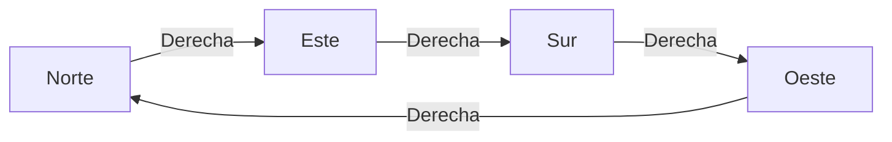
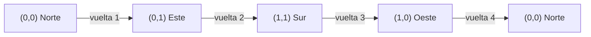

# Proceso del Robot - CÆLUX-4 (Así lo llamé jaja)

El robot está en un estado `Estado(x, y, mira)`. Empieza en
`Estado(0, 0, Norte)`. Avanzar hacia el Norte aumenta `y` y avanzar hacia el Este
aumenta `x`.

## Punto 1 - `Girar`

hay cuatro direcciones y dos sentidos, o sea 8 casos. Uso un
`match` sobre la pareja `(d, s)` y cada `case` dice a en qué dirección se llega.
La función no se llama a ella misma sino que solo busca el caso que corresponda.

| Dirección | Gira a la derecha | Gira a la izquierda |
|---|---|---|
| Norte | Este | Oeste |
| Este | Sur | Norte |
| Sur | Oeste | Este |
| Oeste | Norte | Sur |



**Traza** cuatro giros a la derecha desde el Norte.

| Giro | Pareja `(d, s)` | Resultado |
|---|---|---|
| 1 | `(Norte, Derecha)` | Este |
| 2 | `(Este, Derecha)` | Sur |
| 3 | `(Sur, Derecha)` | Oeste |
| 4 | `(Oeste, Derecha)` | Norte |

Despues de realizar cuatro giros el robot queda mirando otra vez al Norte.

## Punto 2 - `Ejecutar`

`ejecutar(e, o)` recibe el estado y una orden y devuelve el estado
nuevo. Hay un caso por cada tipo de orden:

| Orden | Que hace | Se llama a ella misma? |
|---|---|---|
| `Avanzar(n)` | Cambia `x` o `y` según hacia dónde mira | No |
| `Girar(s)` | Cambia solo `mira`, con `girar` | No |
| `Repetir(veces, orden)` | Ejecuta la orden una vez y repite con `veces - 1` | Si |
| `Secuencia(ordenes)` | Ejecuta la primera y sigue con el resto | Si |

Al avanzar `n` casillas (si `n` es negativo, retrocede):

| Mirando al | Estado nuevo |
|---|---|
| Norte | `Estado(x, y + n, Norte)` |
| Este | `Estado(x + n, y, Este)` |
| Sur | `Estado(x, y - n, Sur)` |
| Oeste | `Estado(x - n, y, Oeste)` |

Los casos de base son `Repetir` con 0 o menos veces y `Secuencia(Nil)`: en los
dos el robot se queda igual.

### Traza 1 - `Avanzar(3)` desde el inicio

| Paso | Orden | Estado antes | Estado después |
|---|---|---|---|
| 1 | `Avanzar(3)` mirando al Norte | `(0, 0, Norte)` | `(0, 3, Norte)` |

### Traza 2 - Secuencia

`Secuencia(List(Avanzar(2), Girar(Derecha), Avanzar(4)))`

| Paso | Orden | Estado antes | Estado después |
|---|---|---|---|
| 1 | `Avanzar(2)` | `(0, 0, Norte)` | `(0, 2, Norte)` |
| 2 | `Girar(Derecha)` | `(0, 2, Norte)` | `(0, 2, Este)` |
| 3 | `Avanzar(4)` | `(0, 2, Este)` | `(4, 2, Este)` |

Asi se encadenan los llamados. Cada vez se ejecuta la primera orden y se
sigue con una secuencia mas corta, hasta llegar a `Secuencia(Nil)`:

```
ejecutar(inicial, Secuencia(List(Avanzar(2), Girar(Derecha), Avanzar(4))))
  ejecutar(inicial, Avanzar(2))                      = (0, 2, Norte)
  ejecutar((0, 2, Norte), Secuencia(List(Girar(Derecha), Avanzar(4))))
    ejecutar((0, 2, Norte), Girar(Derecha))          = (0, 2, Este)
    ejecutar((0, 2, Este), Secuencia(List(Avanzar(4))))
      ejecutar((0, 2, Este), Avanzar(4))             = (4, 2, Este)
      ejecutar((4, 2, Este), Secuencia(Nil))         = (4, 2, Este)  caso base
```

### Traza 3 - Cuadrado

`Repetir(4, Secuencia(List(Avanzar(1), Girar(Derecha))))`

Cada vuelta avanza una casilla y gira a la derecha:

| Paso | Orden | Estado antes | Estado despues |
|---|---|---|---|
| 1 | `Avanzar(1)` | `(0, 0, Norte)` | `(0, 1, Norte)` |
| 2 | `Girar(Derecha)` | `(0, 1, Norte)` | `(0, 1, Este)` |
| 3 | `Avanzar(1)` | `(0, 1, Este)` | `(1, 1, Este)` |
| 4 | `Girar(Derecha)` | `(1, 1, Este)` | `(1, 1, Sur)` |
| 5 | `Avanzar(1)` | `(1, 1, Sur)` | `(1, 0, Sur)` |
| 6 | `Girar(Derecha)` | `(1, 0, Sur)` | `(1, 0, Oeste)` |
| 7 | `Avanzar(1)` | `(1, 0, Oeste)` | `(0, 0, Oeste)` |
| 8 | `Girar(Derecha)` | `(0, 0, Oeste)` | `(0, 0, Norte)` |



El robot termina donde empezó y mirando al mismo lado. Así se encadena el
`Repetir`:

```
ejecutar(e0, Repetir(4, X)) = ejecutar(ejecutar(e0, X), Repetir(3, X))
                            = ejecutar(ejecutar(e1, X), Repetir(2, X))
                            = ejecutar(ejecutar(e2, X), Repetir(1, X))
                            = ejecutar(ejecutar(e3, X), Repetir(0, X))
                            = ejecutar(e4, Repetir(0, X)) = e4   caso base
```

donde `X` es la secuencia del cuadrado y `e1`, `e2`, `e3`, `e4` son los
estados que quedan al final de cada vuelta.

### Traza 4 - casos especiales

| Llamado | Que pasa | Resultado |
|---|---|---|
| `ejecutar(inicial, Avanzar(-2))` | `y + (-2)` mirando al Norte | `(0, -2, Norte)` |
| `ejecutar(inicial, Repetir(0, Avanzar(5)))` | Cae en el caso `veces <= 0` | `(0, 0, Norte)` |

## Punto 3 - `cuantasBasicas` y `profundidad`

Estas funciones **miden** una orden sin ejecutarla, así que el robot no se
mueve. Tienen la misma forma que `ejecutar`, un caso por cada tipo de orden.

**`cuantasBasicas`:**

| Orden | Resultado |
|---|---|
| `Avanzar` o `Girar` | 1 |
| `Repetir(veces, orden)` | `veces` por las de `orden` (0 si `veces <= 0`) |
| `Secuencia(Nil)` | 0 |
| `Secuencia(primera :: resto)` | las de `primera` más las del resto |

Traza para el cuadrado:

```
cuantasBasicas(Repetir(4, Secuencia(List(Avanzar(1), Girar(Derecha)))))
  = 4 * cuantasBasicas(Secuencia(List(Avanzar(1), Girar(Derecha))))
  = 4 * (cuantasBasicas(Avanzar(1)) + cuantasBasicas(Secuencia(List(Girar(Derecha)))))
  = 4 * (1 + (cuantasBasicas(Girar(Derecha)) + cuantasBasicas(Secuencia(Nil))))
  = 4 * (1 + (1 + 0))
  = 8
```

El 8 coincide con los 8 pasos de la traza del cuadrado en el punto 2.

**`profundidad`:**

| Orden | Resultado |
|---|---|
| `Avanzar` o `Girar` | 1 |
| `Repetir(_, orden)` | 1 + la de `orden` |
| `Secuencia(lista)` | 1 + la de la orden más honda de la lista |

La auxiliar `masHonda` recorre la lista y devuelve el mayor valor. Con la
lista vacía devuelve 0.

```
profundidad(Repetir(4, Secuencia(List(Avanzar(1), Girar(Derecha)))))
  = 1 + profundidad(Secuencia(List(Avanzar(1), Girar(Derecha))))
  = 1 + (1 + masHonda(List(Avanzar(1), Girar(Derecha))))
  = 1 + (1 + max(1, masHonda(List(Girar(Derecha)))))
  = 1 + (1 + max(1, max(1, 0)))
  = 1 + (1 + 1)
  = 3
```

Con la secuencia vacía: `profundidad(Secuencia(Nil)) = 1 + masHonda(Nil) = 1 + 0 = 1`.

## Punto 4 - Funciones de alto orden

**`componer(o1, o2)`** devuelve `Secuencia(List(o1, o2))`.

Traza de `componer(Avanzar(1), Girar(Derecha))` desde el inicio:

| Paso | Orden | Estado antes | Estado después |
|---|---|---|---|
| 1 | `Avanzar(1)` | `(0, 0, Norte)` | `(0, 1, Norte)` |
| 2 | `Girar(Derecha)` | `(0, 1, Norte)` | `(0, 1, Este)` |

**`rutina(pasos)(giro)(veces)`** esta currificada. Cuando solo se dan los dos
primeros argumentos, queda una función que espera las veces: `rutina(1)(Derecha)`
es una función de `Int` a `Orden`. Al darle las veces, devuelve
`Repetir(veces, Secuencia(List(Avanzar(pasos), Girar(giro))))`.

Traza de `rutina(3)(Derecha)(2)` desde el inicio:

| Paso | Orden | Estado antes | Estado después |
|---|---|---|---|
| 1 | `Avanzar(3)` | `(0, 0, Norte)` | `(0, 3, Norte)` |
| 2 | `Girar(Derecha)` | `(0, 3, Norte)` | `(0, 3, Este)` |
| 3 | `Avanzar(3)` | `(0, 3, Este)` | `(3, 3, Este)` |
| 4 | `Girar(Derecha)` | `(3, 3, Este)` | `(3, 3, Sur)` |

Con `rutina(1)(Derecha)(4)` se obtiene el cuadrado del punto 2 que vuelve a
`(0, 0, Norte)`.

**`aplicarA(estados, o)`** ejecuta la misma orden sobre cada estado, con `map`.

Traza de `aplicarA(List(inicial, Estado(5, 5, Sur)), Avanzar(2))`:

| Estado de entrada | Avanzar(2) | Estado de salida |
|---|---|---|
| `(0, 0, Norte)` | `y + 2` | `(0, 2, Norte)` |
| `(5, 5, Sur)` | `y - 2` | `(5, 3, Sur)` |

**`transformar(o, f)`** aplica `f` solo a las ordenes basicas y respeta la
estructura de `Repetir` y `Secuencia`. Es recursiva.

```
transformar(Repetir(4, Secuencia(List(Avanzar(1), Girar(Derecha)))), f)
  = Repetir(4, transformar(Secuencia(List(Avanzar(1), Girar(Derecha))), f))
  = Repetir(4, Secuencia(List(transformar(Avanzar(1), f), transformar(Girar(Derecha), f))))
  = Repetir(4, Secuencia(List(f(Avanzar(1)), f(Girar(Derecha)))))
  = Repetir(4, Secuencia(List(Avanzar(2), Girar(Derecha))))      con f = duplicar avances
```

Traza de posiciones del resultado:

| Vuelta | Después de avanzar 2 | Después de girar |
|---|---|---|
| 1 | `(0, 2, Norte)` | `(0, 2, Este)` |
| 2 | `(2, 2, Este)` | `(2, 2, Sur)` |
| 3 | `(2, 0, Sur)` | `(2, 0, Oeste)` |
| 4 | `(0, 0, Oeste)` | `(0, 0, Norte)` |

## Punto 5 - `Simplificar`

simplifico de adentro hacia afuera. Primero simplifico cada orden
que está adentro, y con esos resultados limpios aplico las reglas. Así una
pasada deja todo simplificado, porque lo de adentro ya está listo cuando se
mira lo de afuera.

| Regla | Qué hace | Dónde se aplica |
|---|---|---|
| 1 | `Avanzar(0)` y `Repetir(0, _)` se vuelven `Secuencia(Nil)` | casos `Avanzar(0)` y `Repetir(veces, _)` con `veces <= 0` |
| 2 | Dos `Avanzar` seguidos se juntan | auxiliar `juntar` |
| 3 | `Repetir(1, o)` se vuelve `o` | caso `Repetir(1, orden)` |
| 4 | Una secuencia de un elemento se vuelve ese elemento | final del caso `Secuencia` |
| 5 | Lo que no hace nada se quita de las secuencias | `filter` dentro del caso `Secuencia` |

Para una `Secuencia` los pasos son simplificar cada elemento, quitar los que
quedaron en `Secuencia(Nil)`, juntar los `Avanzar` que estan con `juntar`,
quitar `Avanzar(0)` y decidir si queda vacía, de un elemento o de
varios.

### Traza 1

`Secuencia(List(Avanzar(1), Avanzar(2), Girar(Derecha), Avanzar(3)))`

| Paso | Qué pasa | Lista |
|---|---|---|
| 1 | Cada elemento ya está simple | `Avanzar(1), Avanzar(2), Girar(Derecha), Avanzar(3)` |
| 2 | `juntar` suma los dos primeros avances | `Avanzar(3), Girar(Derecha), Avanzar(3)` |
| 3 | Quedan tres elementos | `Secuencia(List(Avanzar(3), Girar(Derecha), Avanzar(3)))` |

Posiciones del robot en ambas versiones:

| Versión | Paso a paso | Estado final |
|---|---|---|
| Original | `(0,1,N)`, `(0,3,N)`, `(0,3,E)`, `(3,3,E)` | `(3, 3, Este)` |
| Simplificada | `(0,3,N)`, `(0,3,E)`, `(3,3,E)` | `(3, 3, Este)` |

### Traza 2 - Una secuencia dentro de otra

`Secuencia(List(Secuencia(List(Avanzar(1), Avanzar(2))), Avanzar(4)))`

| Paso | Qué pasa | Resultado |
|---|---|---|
| 1 | Se simplifica la secuencia de adentro: junta `1 + 2` | `Avanzar(3)` |
| 2 | Quedan `Avanzar(3)` y `Avanzar(4)` | `List(Avanzar(3), Avanzar(4))` |
| 3 | `juntar` suma los dos | `List(Avanzar(7))` |
| 4 | Un solo elemento: la secuencia se vuelve ese elemento | `Avanzar(7)` |

Posiciones: el original pasa por `(0,1,N)`, `(0,3,N)` y `(0,7,N)`, y el
simplificado avanza 7 y llega a `(0, 7, Norte)`. Es el mismo estado final.

### Traza 3 - casos que no hacen nada

| Entrada | Qué pasa | Resultado | Estado desde el inicio |
|---|---|---|---|
| `Repetir(0, Avanzar(9))` | Cae en `veces <= 0` | `Secuencia(Nil)` | `(0, 0, Norte)` en ambos |
| `Secuencia(List(Avanzar(0), Girar(Derecha)))` | `Avanzar(0)` se quita y queda un elemento | `Girar(Derecha)` | `(0, 0, Este)` en ambos |
| `Secuencia(List(Avanzar(2), Avanzar(-2)))` | Se juntan en `Avanzar(0)`, que se quita | `Secuencia(Nil)` | `(0, 0, Norte)` en ambos |

La profundidad de las llamadas de `simplificar` depende de qué tan anidada
esté la orden, o sea de su `profundidad`.